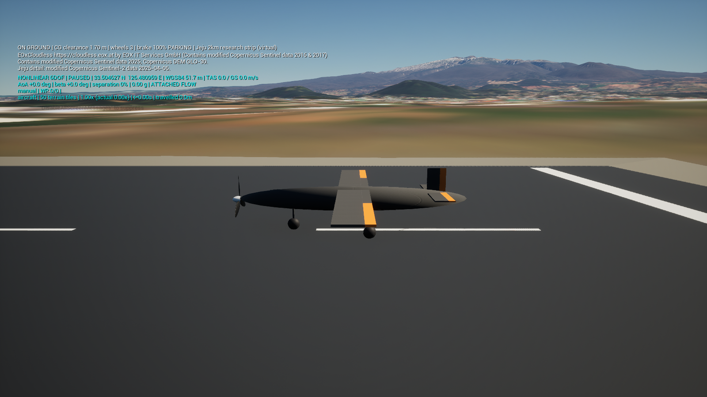
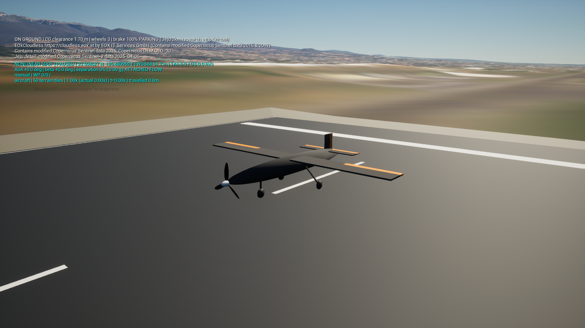

# 주기어 연결·프로펠러 표시 수정 — 2026-11-18

사용자 화면에서 주기어가 꼬리 쪽에 붙어 보이고 회전 프로펠러가 막대처럼 보이는 문제를 수정했다. 실제 C208B CAD를 도입한 것은 아니며 연구용 내장 외형이다.

## 주기어

기존 바퀴 바로 위의 수직 막대는 동체 폭 밖에 있어 동체에 연결되지 않았다. 낮은 후방 카메라에서는 꼬리 주변에 매달린 것처럼 보였다. 동체 측면의 내부 점에서 주기어 바퀴 중심까지 이어지는 경사 지지대로 바꿨다. 바퀴/접촉점을 임의로 옮겨 외형을 맞추지 않았다. 현 연구 프로필의 CG 기준 FRD 접촉점은 전륜 `(3.2,0,1.7)m`, 주륜 `(-.8,±1.8,1.7)m`이고, 바퀴 반경은 .32m다. 이 값은 기존 개발 가정이다.

렌더의 양쪽 주기어 지지대 상단이 동체 안쪽에 있고 하단은 물리 바퀴 중심에 도달하는지 실제 Unreal 변환값으로 검사했다. 측면에서 주기어가 주날개 뒤·동체 아래에 배치되는 것도 확인했다.



## 프로펠러

외부 에셋을 내려받는 대신 프로젝트에서 생성하는 메시를 직접 만들었다. `Source/UAVSim/PropellerGeometry.h`는3엽의 둥근 단면·테이퍼·곡선 팁·기하학적 비틀림과 스피너를 만든다. 프로필의 `propeller_radius_m`를 사용하며 꼬임/시위 비율은 표시용 가정이다. 기존 큐브 막대는 제거했다. 회전축은 기체 +X이며 회전면은 YZ다.

낮은 회전에서는 블레이드를 보여 주고, 표시 회전수2~5회/s에서 블레이드와 잔상 디스크의 불투명도를 부드럽게 교차 전환한다. 고속에서는 축대칭·가장자리가 흐린 반투명 디스크를 사용해 프레임 샘플링에 따른 정지/역회전 착시를 줄인다. 투명 머티리얼은 `Content/Materials/M_PropellerVisual.uasset`다. 회전 중인 막대 그림자도 제거했다.




표시 회전수는 실제 스로틀/출력에 비례하는 기존 개발 애니메이션이다. **실제 RPM·셔터 노출·프로펠러 토크·공력 모델이 아니다.** 수식과 단위를 따르는 기존 비행역학/접촉 계산은 이번 표시 수정 대상에 넣지 않았다.

배치의 정성적 참고는 [NTSB 공개 보고서의 Textron 208B 3면도, 그림1](https://data.ntsb.gov/Docket/Document/docBLOB?FileExtension=pdf&FileName=WPR23FA034+Structures+Factual-Rel.pdf&ID=17545448)다. 보고서는 EX 구성도 포함하므로 그 엔진/4엽 프로펠러 제원을 현 연구 모델에 혼합하지 않았다. 외부 메시나 이미지를 제품 에셋으로 복제하지 않았다.

## 검사·재실행

Unreal5.8.4 Development 빌드와 별도 C++ `propeller_visual_checks`가 통과했다. 메시의 유한성·인덱스·반경·3엽 대칭과 부드러운 교차 전환을 검사했다. [실제 표시 검사](../artifacts/propeller-visual/result.json)는 동체/바퀴 연결·저속 블레이드/고속 잔상·공중 회전과 장면6개를 확인한다. 컴퓨터/UI 자동화 없이 제품 API와 개발용 Remote Control 속성/캡처를 사용했다. 제품 endpoint나 상태 스키마는 추가하지 않았다.

```powershell
# C208B 연구 프로필과 관리형 Unreal/API가 실행된 상태. 비행을 초기화한다.
.\.venv\Scripts\python.exe scripts/check-propeller-visual.py
```

검사 종료는 지상 주차·일시정지·기본 추적 카메라다. 이전 비행 시간/동역학을 복원하지 않는다. 수정 전 실행 상태는 `artifacts/model-visual-before.json`에 보존했다. 기존 프로필은 그대로 적용되어 있다.

머티리얼을 재생성해야 하는 개발 환경에서는 다음 명령을 실행한다. 기존 머티리얼은 덮어쓰지 않고 읽어 확인한다.

```powershell
& 'C:\UnrealEngine-release\Engine\Binaries\Win64\UnrealEditor-Cmd.exe' "$PWD\UAVSim.uproject" -run=pythonscript "-script=$PWD\scripts\prepare-propeller-material.py" -unattended -nop4 -nullrhi
```
