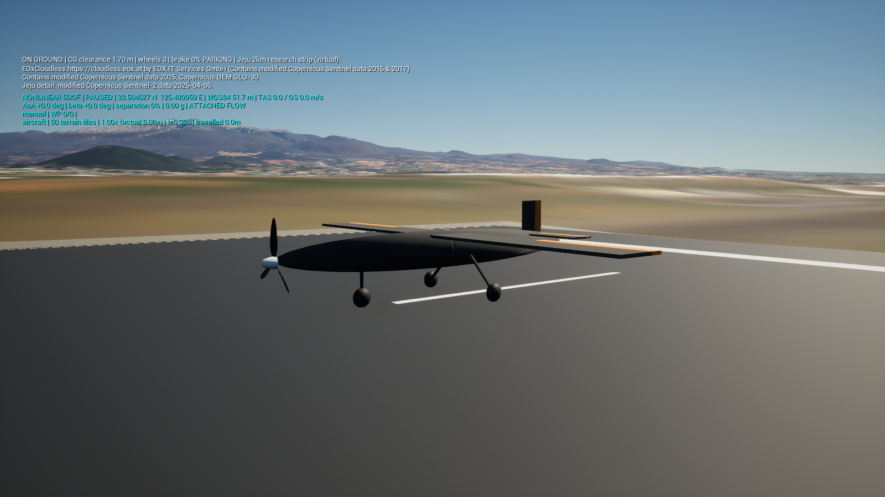
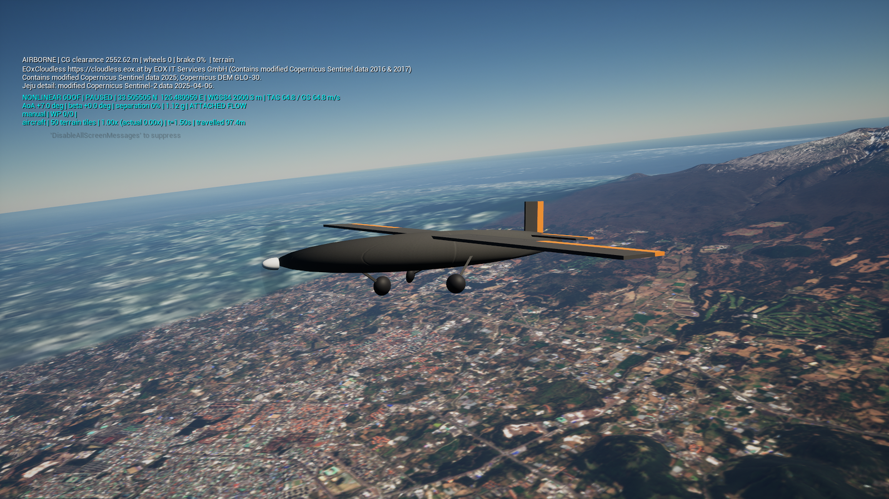
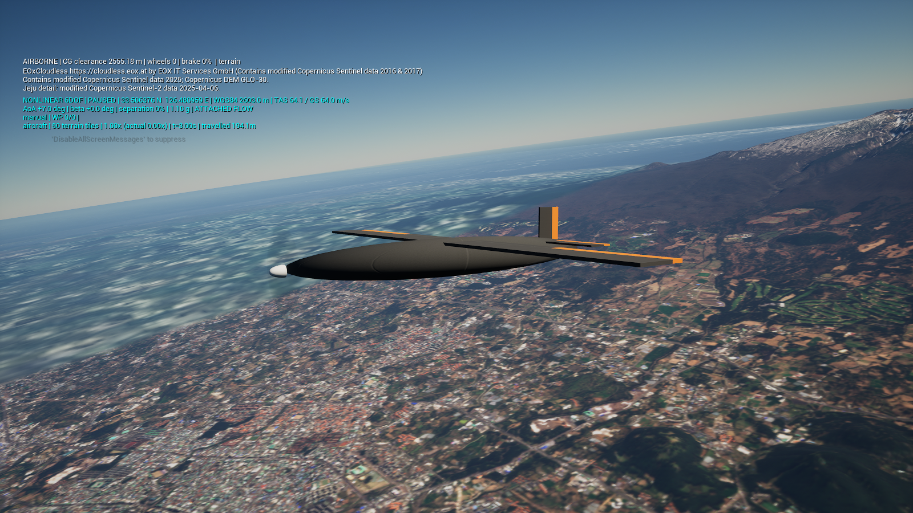

# 접히는 랜딩기어 연구 구성 — 2026-11-18

후속 [항법·물리 통합 개선](navigation-physics.md)에서 같은 수납식 연구 파일에 동적 추진·타이어 연구값을 추가하고 무풍/작은 바람의20km 연속 왕복도 확인했다. 아래는 수납식 기어를 처음 추가했을 때의 기록이다.

사용자 요청으로 기본 선택을 `aircraft/c208b-retractable-research.json`으로 바꿨다. 기존 고정기어 `c208b-research.json`을 복사해 **가상의 수납식 기어를 적용한 별도 연구 기체**다. 실제 C208B의 수납식 사양이라고 취급하지 않는다. 새 id는 `c208b-retractable-research-assumptions`이며 API/화면의 support_message도 가상 구성·성능 미검증을 표시한다.

동체에 고정된 힌지를 중심으로 전륜은 뒤로, 주륜은 앞/안쪽으로 회전한다. 기존처럼 바퀴 쪽을 중심으로 돌아가는 표시를 고쳤다. 전개 상태의 바퀴 바닥은 기존 물리 접촉점과 일치한다. 전개율에 따라 quaternion으로 연속 회전하며, 완전 수납 시 동체 안의 기어 표시를 숨긴다. 수납실 도어·유압·실제 링크 기구는 구현하지 않았다.

## 화면에서 보기

1. **지상 시작 → 자동 이륙**으로 실행한다. 지면 기준10m 이상 상승 중 수납을 시작하고3초 시뮬레이션 시간에 접힌다.
2. **자동 착륙** 인가 시 전개를 시작한다. 실제 전개 잠금이 확인돼야 바퀴 접촉을 지지한다.
3. 수동으로 보려면 **공중 초기화** 뒤 자동 운항을 해제한 상태에서 **기어 수납/전개 → 재생**을 누른다. 일시정지 중에는 명령만 바뀌므로 재생 또는 명시적 step이 필요하다.

지상 수납과 활성 자동 이착륙 중 수동 기어 명령은 기존처럼 거절한다. Web UI는 수납식/고정기어 종류와 이동률·잠금을 보여 준다.3초는 벽시계가 아닌 시뮬레이션 시간이며 배속 시 화면 시간은 달라진다.

```python
from uavsim_client import UAVSimClient
sim=UAVSimClient()
sim.pause()
sim.reset()  # 공중 초기화, 이전 비행 교체
print(sim.get_state()['airframe']['retractable_gear'])  # True
sim.set_landing_gear(False)
print(sim.step(1)['gear'])
print(sim.step(.5)['gear'])  # 전개율 .5, 잠금 없음
print(sim.step(1)['gear'])
print(sim.step(.5)['gear'])  # 수납 잠금
sim.set_landing_gear(True)
for _ in range(3): sim.step(1)
```

새 endpoint는 없으며 기존 `PUT /api/v1/gear`, Python `set_landing_gear`와 UI를 사용한다. 완전 전개 대비 기존 연구 항력 보정 `.012*(extension-1)`을 적용한다. 이 값과 접촉 치수·3초 행정·힌지/수납 경로는 모두 개발 가정이며 실제 기어 성능 자료가 아니다.

## 확인 결과

Unreal5.8.4 Development 빌드와 Release CTest **14/14**가 통과했다. 새 `retractable_checks`는 전개 바퀴/접촉점 일치·동체 부착과 같은 물리의 이륙→자동 수납→귀환→전개 잠금→접지·주차를 확인했다. 기존 고정기어·Thor 검사는 유지했다.

[실제 Unreal 기어 검사22개](../artifacts/retractable-gear-check.json)가 통과했다. 제품 요청215회·native 속성 조회24회에서3초 행정·1.5초 중간 위치·반전·배속 독립 재현·지상 거절·자동 이륙 수납·착륙 전개/접지·주차를 확인했다. 종료 상태는 현재 새 프로필·지상 전개·주차·1배속·일시정지다.





```powershell
# 실행 중인 Unreal과 수납식 연구 프로필 필요. 현재 비행을 초기화한다.
.\.venv\Scripts\python.exe scripts/check-gear-api.py --output artifacts/retractable-repeat.json --capture
```

실기체 구성/성능·도어/유압·정밀 기구 검증은 하지 않았다. 이전 원거리 왕복 수치 기록은 고정기어 프로필의 기록이며 새 구성의 장거리 실증으로 바꿔 부르지 않는다.
